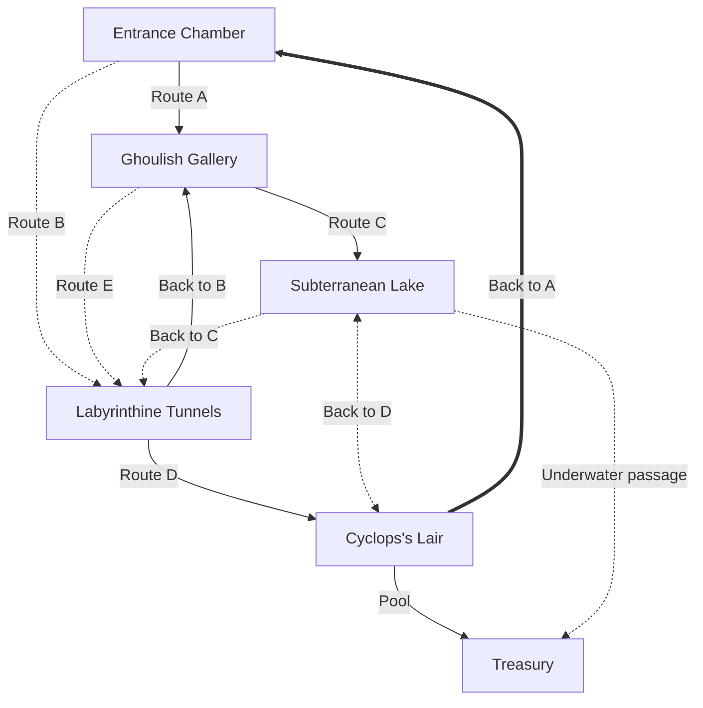

![[Encounter distances - rules cyclopedia#^basicdngdistanceroll]]
# Rooms
## Room 1
![[01 GM/Campaigns/The Arendur Rising Campaign/12 Adventures & Events/Caves of Shadow - main/Room 1 Caves of Shadow Entrance Chamber]]

### Route A: Cursed Corridor
(Connecting Entrance Chamber to Ghoulish Gallery) 
- The walls are adorned with faintly glowing runes(lime green), remnants of the necromancer's dark magic. 
- They runes provide dim light, creating an eerie ambiance.
- The air is thick with the scent of decay, and (**if the ghouls are alive**: *the distant echoes of moans and whispers can be heard)*. 
- rough natural walls and floor, the floor is uneven, fast movement requires athletics check DC 12

`dice: 1[[Cave and tunnel features#^e4abb7]]`
### Route B: Spider's Silk Passage
(Connecting Entrance Chamber to Labyrinthine Tunnels) 
This route takes the party through narrow passages lined with spider webs. The air is filled with the acrid smell of silk, and the ground is covered in a layer of sticky residue. Sounds of skittering arachnids can be heard from adjacent chambers, hinting at the dangers that may lurk nearby.

Features:

- Difficult Terrain: The sticky residue on the ground requires careful navigation to avoid getting entangled.
- Smell: The acrid smell of spider silk permeates the air, signaling the presence of giant spiders.
- Sound: Skittering noises from nearby chambers indicate the potential threat of arachnids.

`dice: 1[[Cave and tunnel features#^e4abb7]]`
### Back to A (Entrance Chamber):
- **Magical Barrier:**
	- A magical barrier, woven with ancient cyclops runes, blocks direct access from the Entrance Chamber to the Cyclops's Lair.
    - The barrier is tied to the cyclops's lair, and its purpose is to deter intruders from reaching the lair too easily.
- **Clue Mechanism:**
	- A successful DC 17 Intelligence (Arcana) check reveals that the magical barrier is attuned to the cyclops's presence and must be deactivated from the lair side.
    - Clues throughout the dungeon hint at the cyclops's vulnerability, encouraging players to explore and discover ways to bypass the magical barrier.
- **Story Element:**
	- The magical barrier serves as a security measure implemented by the cyclops to protect its lair. The players must unravel the mystery and vulnerabilities of the cyclops to proceed.
`dice: 1[[Cave and tunnel features#^e4abb7]]`
## Room 2 - Ghoulish Gallery
![[01 GM/Campaigns/The Arendur Rising Campaign/12 Adventures & Events/Caves of Shadow - main/Room 2 - Ghoulish Gallery - caves of shadows]]
### Route E: Shortcut to Spider Silk
(Connecting Ghoulish Gallery to Route B spider silk passage) 
`dice: 1[[Cave and tunnel features#^e4abb7]]`
### Back to B (Ghoulish Gallery):
- This connection allows the party to return from the Labyrinthine Tunnels to the Ghoulish Gallery.
- Initially, the connection is unnoticeable due to a magically concealed entrance in the Labyrinthine Tunnels. A successful DC 15 Wisdom (Perception) check reveals the hidden passage.
- `dice: 1[[Cave and tunnel features#^e4abb7]]`
### Route C: Whispering Wind Tunnel
(Connecting Ghoulish Gallery to Subterranean Lake) 
This winding tunnel is filled with a gentle breeze that carries mysterious whispers. The walls are covered in intricate carvings depicting forgotten tales. The air is cool and refreshing, a stark contrast to the oppressive atmosphere of the ghoulish gallery.

Features:

- Sound: Mysterious whispers carried by the gentle breeze, hinting at the hidden stories depicted on the carvings.
- Scenic: Intricate carvings on the walls tell tales of the cave's history, offering a moment of appreciation.
- Contrast: The transition from the ghoulish gallery's decayed scent to the fresh, cool air in the tunnel is palpable.
- `dice: 1[[Cave and tunnel features#^e4abb7]]`

### Route A: Cursed Corridor
(Connecting Entrance Chamber to Ghoulish Gallery) 
This route is characterized by a dimly lit corridor that exudes an unsettling aura. The walls are adorned with faintly glowing runes, remnants of the necromancer's dark magic. The air is thick with the scent of decay, and the distant echoes of moans and whispers can be heard, hinting at the lingering presence of undead in the connecting rooms.

Features:
- Illumination: Faintly glowing runes on the walls provide dim light, creating an eerie ambiance.
- Smell: The scent of decay grows stronger as the party progresses, indicating the proximity of undead.
- Sound: Distant moans and whispers echo through the corridor, raising tension.
- `dice: 1[[Cave and tunnel features#^e4abb7]]`

## Room 3: Labyrinthine Tunnels
![[01 GM/Campaigns/The Arendur Rising Campaign/12 Adventures & Events/Caves of Shadow - main/Room 3 - Labyrinthine Tunnels - caves of shadow]]

## Room 4: Lake
![[01 GM/Campaigns/The Arendur Rising Campaign/12 Adventures & Events/Caves of Shadow - main/Room 4 Subterranean Lake - Caves of shadow]]
## Room 5: Cyclops's Lair
The chamber is vast, and the ceiling is high enough to accommodate the towering figure of the cyclops. Stalagmites and stalactites cast elongated shadows across the room. The cyclops, wielding a massive club, roars in anger at the intruders.

- Charisma (Persuasion) - DC 18 To negotiate with the cyclops, convincing it to abandon its pillaging plans in exchange for information about the necromancer's whereabouts. A failed check may lead to a combat encounter.
- Stalagmites and stalactites, Massive club, Cyclops The stalagmites and stalactites create natural cover and opportunities for strategic positioning. The massive club wielded by the cyclops poses a significant threat, dealing massive damage. Negotiating with the cyclops provides a chance to avoid a potentially challenging combat encounter. -GM Note The cyclops's lair is filled with treasures collected during its pillaging endeavors. The negotiation option emphasizes alternative approaches to conflict resolution.
- Exits One exit leads back to the labyrinthine tunnels (Route D), and another exit leads to a hidden chamber accessible via the underwater passage (Route E).

# Routes
## Route D: Murmuring River Path
(Connecting Labyrinthine Tunnels to Cyclops's Lair) 
This route leads the party along the banks of an underground river. The sound of flowing water is ever-present, and occasional echoes hint at the vastness of the cavern. The ground is uneven, with patches of moss and loose stones.

Features:

- Sound: The constant murmur of the underground river creates a soothing backdrop.
- Difficult Terrain: Uneven ground with patches of moss requires careful navigation.
- Clue: Faint echoes of the cyclops's roars can be heard from the direction of the cyclops's lair.

# Back Routes
## Back to D (Subterranean Lake):
- This connection enables the party to return from the Cyclops's Lair to the Subterranean Lake.
- The passage leading back to the Subterranean Lake is initially blocked by a massive stone door that requires a DC 18 Strength (Athletics) check to open. Alternatively, the players may find a lever in the Cyclops's Lair to unlock the door.
## Back to C (Labyrinthine Tunnels):
- This connection allows the players to return from the Subterranean Lake to the Labyrinthine Tunnels.
- The entrance to the Labyrinthine Tunnels is concealed by an illusory wall in the Subterranean Lake. A successful DC 16 Intelligence (Investigation) check reveals the illusion.
### Additional Details:
- **Secret Connections:** Back to B and Back to C are initially secret connections, requiring successful skill checks to be revealed. This adds an element of exploration and discovery for the players.
    
- **Environmental Interaction:** Back to D involves a physical obstacle (massive stone door) that can be interacted with. This creates an opportunity for players to use their Strength and problem-solving skills.
    
- **Story Integration:** The concealed entrances and obstacles are deliberate actions taken by the cyclops to secure its lair. The cyclops, being cunning, intentionally hides these routes to protect itself and its treasures.
    
- **Clue Integration:** Clues regarding the concealed entrances may be discovered in adjacent rooms or through careful observation. For example, inscriptions in the Labyrinthine Tunnels hint at a hidden passage leading back to the Ghoulish Gallery.
    

You

i have questions: back to A. Can the players shortcut the entire dungeon by taking this route from entrance chamber to cyclops lair?

ChatGPT

ChatGPT

Good point. To prevent the players from easily bypassing the entire dungeon, let's introduce a one-way magical barrier that prevents direct access from the Entrance Chamber to the Cyclops's Lair using the "Back to A" connection. This magical barrier can be tied to the cyclops's lair, and its removal or deactivation could be a significant part of the players' quest.

By introducing this magical barrier, you ensure that the players cannot shortcut the entire dungeon by using the "Back to A" connection. They must engage with the dungeon's features and discover the cyclops's weaknesses to progress through the dungeon effectively.

You

another question: Back to C says from subterranean lake to the labyrinthine tunnels. But on your map, "back to C" connects from Cyclops lair to Labyrinthine tunnels.

ChatGPT

ChatGPT

I appreciate your observation. It seems there was a mistake in the labeling of the connection. Let's correct that:

### Back to C (Subterranean Lake):

- **Connection Correction:**
    
    - The "Back to C" connection connects from the Subterranean Lake to the Labyrinthine Tunnels, as initially intended.
- **Description:**
    
    - This connection allows the party to return from the Subterranean Lake to the Labyrinthine Tunnels.
    - The entrance to the Labyrinthine Tunnels is concealed by an illusory wall in the Subterranean Lake. A successful DC 16 Intelligence (Investigation) check reveals the illusion.

Thank you for bringing this to my attention. If you have any further questions or adjustments, feel free to let me know!

You

Room 4 and Room 5 has some discrephancies about the underwater passage. Several places you reference a secret area. But this secret area does not have a room description and does not figure in the mermaid map.

ChatGPT

ChatGPT

You're correct, and I appreciate your diligence in catching that discrepancy. Let's clarify the details for Room 4 (Subterranean Lake) and Room 5 (Cyclops's Lair) regarding the underwater passage and the secret area:

### Room 4: Subterranean Lake

The tunnel opens up into a vast chamber with a subterranean lake at its center. The air is humid, and the sound of dripping water is replaced by gentle lapping waves. The lake shimmers with an otherworldly phosphorescence.

- **Wisdom (Perception) - DC 16**
    
    - To notice a hidden underwater passage, accessible by swimming through the phosphorescent lake. A successful DC 14 Strength (Athletics) check is required to navigate the strong underwater currents.
- **Features:**
    
    - **Subterranean lake:** The phosphorescent glow of the lake provides an ethereal ambiance.
    - **Phosphorescent glow:** The glow creates an otherworldly atmosphere in the cavern.
    - **Hidden underwater passage:** Requires a successful Perception check to notice. Leads to a secret area.
- **GM Note:**
    
    - The underwater passage connects to a secret area containing valuable loot and a clue about the cyclops's lair.
- **Exits:**
    
    - Aside from the entrance, the lake has a hidden underwater passage that leads to a secret area.

### Secret Area (Connected to Subterranean Lake via Underwater Passage)

- **Description:**
    
    - This concealed area is a hidden cavern filled with ancient artifacts and treasures, gathered by the cyclops during its pillaging endeavors.
    - The remains of previous adventurers who failed to navigate the underwater passage are scattered here.
- **Features:**
    
    - **Treasures:** Ancient artifacts and valuables collected by the cyclops.
    - **Clue:** A clue about the cyclops's lair and weaknesses.
    - **Hazards:** The remains of previous adventurers may animate as undead if disturbed.

### Room 5: Cyclops's Lair

The chamber is vast, and the ceiling is high enough to accommodate the towering figure of the cyclops. Stalagmites and stalactites cast elongated shadows across the room. The cyclops, wielding a massive club, roars in anger at the intruders.

- **Charisma (Persuasion) - DC 18**
    
    - To negotiate with the cyclops, convincing it to abandon its pillaging plans in exchange for information about the necromancer's whereabouts. A failed check may lead to a combat encounter.
- **Features:**
    
    - **Stalagmites and stalactites:** Create natural cover and opportunities for strategic positioning.
    - **Massive club:** Wielded by the cyclops, posing a significant threat.
    - **Negotiation option:** Provides a chance to avoid a potentially challenging combat encounter.
- **GM Note:**
    
    - The cyclops's lair is filled with treasures collected during its pillaging endeavors. The negotiation option emphasizes alternative approaches to conflict resolution.
- **Exits:**
    
    - One exit leads back to the labyrinthine tunnels (Route D), and another exit leads to a hidden chamber accessible via the underwater passage (Route E).

This should address the discrepancy, providing a more coherent description of the secret area connected to the underwater passage in Room 4 and its role in the overall dungeon.

The cyclops hides its hoard in the underwater area for several strategic reasons:

1. **Security and Concealment:**
    
    - The underwater area provides a natural layer of security, as many creatures, especially humanoid adventurers, might not be adept at navigating underwater passages.
    - The phosphorescent glow of the lake helps conceal the entrance to the hidden area, making it less likely to be discovered by casual observers.
2. **Protection from Thieves:**
    
    - Cyclopes, being solitary creatures, are often wary of other creatures, including potential thieves or rival monsters in the cave system.
    - By placing the hoard in an underwater location, the cyclops creates an additional barrier that only it can easily navigate, minimizing the risk of theft.
3. **Environmental Advantage:**
    
    - The cyclops may have an affinity for underwater environments or may be naturally adapted to swimming. This would give the cyclops an advantage in accessing and guarding its hoard.
4. **Personal Preference:**
    
    - The cyclops might simply prefer the ambiance of the underwater area for its hoard. The phosphorescent glow, combined with the hidden nature of the location, could appeal to the cyclops's sense of aesthetics.

As for how the cyclops accesses its hoard:

1. **Swimming Abilities:**
    
    - The cyclops possesses the ability to swim, allowing it to navigate the underwater passage effortlessly.
    - Its size and strength make it well-suited for underwater travel, and the cyclops may even find the underwater environment comforting or familiar.
2. **Guarded Entrance:**
    
    - The cyclops likely keeps the entrance to the underwater passage guarded or concealed to prevent other creatures from stumbling upon it.
    - The cyclops may have a specific routine or trigger to open the entrance when it needs to access its hoard, ensuring that it remains hidden and secure.
3. **Cyclops's Knowledge:**
    
    - The cyclops, being an intelligent creature, understands the advantages of its chosen hiding spot. It may have learned about the underwater passage's existence through natural exploration or previous experiences.

Overall, the combination of environmental advantage, security considerations, and personal preferences leads the cyclops to hide its hoard in the underwater area, making it a well-protected and concealed treasure trove.

#Arendur